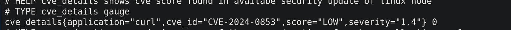

# Repo Info

- repo for exporter that exposes security information about installed packages and CVE relevant infoa


## Requriements before running the application 

- puppet must be installed 
- For distro's which use YUM, the application expects `yum security plugin and yum changelog plugin` to be installed


## Doing a test run on an actual server

For doing a test run on an actual server you need to set `run_type` in config.yaml which is located at `/etc/obmondo-security-exporter/config.yaml
`. Be sure to look at [obmondo-security-exporter.service](./obmondo-security-exporter.service)

```yaml 
server:
  run_type: testing
```

### Enviroment variables list 

```
SERVER_PORT - this will run server on specified port
LOGGING_LEVEL - supports debug, info, warn, error ENUMS for logging level(Note this cannot be configuared via YAML file)
CVE_API_TIMEOUT - sets timeout for request to 3rd party api 
CVE_API_REQUEST_INTERVAL - sets time interval between each request  to avoid getting rate limited
CVE_API_URL - sets 3rd party API url which will have and endpoint that will give us cve-number info
CVE_API_ENDPOINT - sets 3rd party endpoint on which request will be sent to get info
CRON_EXPRESSION - this will basically set how many times this program will check for security updates and give CVE-number for them
```

- if you don't like using Enviroment variables you can use YAML config, please check [this link](./config/config.test.yaml)

### Metrices output sample
```
# HELP cve_details shows cve score found in availabe security update of linux node
# TYPE cve_details gauge
general_cve_details{application="bar",cve_id="CVE-2024-0855",severity="1.5"} 0
general_cve_details{application="curl",cve_id="CVE-2024-0853",severity="1.4"} 0
general_cve_details{application="foo",cve_id="CVE-2024-0855",,severity="1.6"} 0
```


